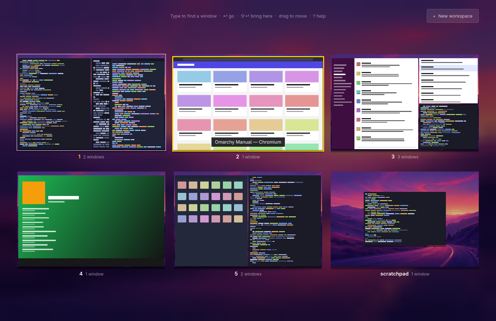

# omission

Mission Control for Omarchy. One keystroke shows every workspace and every
window on it, live, and your current workspace zooms out of the screen into
its place among them.



## Why it's fast

Every choice here comes from measurements on a real Omarchy machine (an M3
MacBook under Asahi), using `OMISSION_DEBUG=1`.

- **It stays resident.** `omission daemon` starts once with the overview
  already built. Opening it is one socket write and a Hyprland state refresh
  of a couple of milliseconds, with no process start and no QML to load.
- **It's a full-screen window, not an overlay.** Under a full-screen layer
  surface, Hyprland redraws every window beneath it on each frame, and on
  this machine that ran at about 30 fps. Under a full-screen window it
  doesn't. A runtime window rule keeps it floating (so tiling never
  reflows), borderless and unanimated. The first frame arrives about 25 ms
  after the keypress.
- **Captures never touch the CPU.** Windows are captured with
  `ext-image-copy-capture` into dmabufs in the GPU's own tiled format.
  Hyprland just renders each window into the buffer. The overview imports
  the buffer as an EGL image, halves it and builds mipmaps on the GPU.
  Shared-memory capture made Hyprland read every window back on its render
  loop, stalling the whole desktop (the cursor included) for ~12 ms per
  window. That path remains only as a fallback.
- **Very little is captured.** The current workspace is captured when the
  overview opens. A hidden workspace is captured once, a moment after you
  leave it, and isn't captured again until it has been on screen. Nothing is
  captured while the overview sits open, and a buffer the compositor hasn't
  finished is never waited on.
- **No per-frame effects.** The blurred backdrop is a tiny decode of your
  wallpaper stretched across the screen.

## Use

| Key | Does |
| --- | --- |
| type | Find windows by title or app |
| `↵` | Go to the selected window |
| `⇧ ↵` / Shift+click | Bring the selected window to this workspace |
| `← → ↑ ↓` | Select the nearest window that way, across workspaces |
| `Tab` / `⇧ Tab` | Select the next / previous window |
| `1` … `9` | Go to that workspace |
| `Del` / `Ctrl+W` | Close the selected window |
| `?` | Show every shortcut |
| `Esc` | Clear the search, or close the overview |

With the mouse: click a window to go to it, or click a workspace to switch
to it. Drag a window onto another workspace to move it there, or onto
**+ New workspace** to give it one of its own. A middle click closes a
window.

When the overview opens, the window you used before the current one is
selected, so `↵` flips back to it the way Alt+Tab does.

## Set up

```sh
bin/install
```

This builds and installs the package, then sets up Hyprland:

- **SUPER + D** toggles the overview, and so does the **Mission Control key** (F3 on Apple keyboards, `XF86LaunchA`)
- **a three-finger swipe up** opens it, and **a swipe down** closes it, like on a Mac
- **the daemon starts with Hyprland**, so the overview opens instantly

It also starts the daemon right away. The script refuses to take a key
that's already bound. Choose another key with `--key "SUPER + O"`, or pass
`--force` to replace the current binding. `--no-key`, `--no-gesture`,
`--no-mission-key`, `--no-autostart` and `--no-config` leave the matching parts out.

The setup sits between `-- omission: start` and `-- omission: end` markers in
`~/.config/hypr/bindings.lua` and `autostart.lua`. Each file is backed up
beside itself first. If Hyprland reports config errors afterwards, the
backups are restored. Run `bin/hypr-config add` or `bin/hypr-config remove`
to change only the config.

```sh
bin/uninstall                 # stop it, remove the config blocks and the package
bin/uninstall --keep-package  # only remove the Hyprland setup
```

omission adds its own Hyprland window rule at runtime (floating, full screen,
no animation or border). Uninstalling leaves nothing behind.

Commands: `omission [toggle|show|hide|daemon|quit]`.

## Develop

```sh
bin/build            # build/omission
bin/test             # unit tests, offscreen
OMISSION_DEBUG=1 build/omission daemon   # traces captures, imports and frame gaps
OMISSION_SHM=1 build/omission daemon     # force the shared-memory fallback
OMISSION_NO_CAPTURE=1 build/omission daemon  # rule captures out when profiling
```

The code is C++ and Qt Quick, built with qmake. `src/capturer.cpp` handles
Wayland capture, `src/model.cpp` turns Hyprland's JSON into workspaces and
the grid, `src/backend.cpp` opens and closes the overview, and
`src/Main.qml` draws the overview and plays the zoom.

## License

MIT
